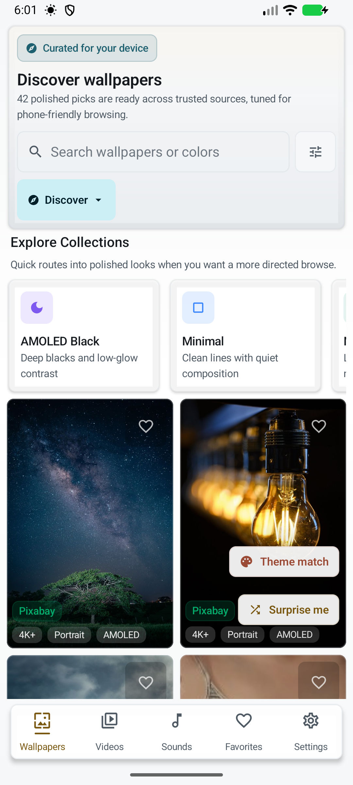

<p align="center">
  
</p>

<h1 align="center">Aura</h1>


<p align="center">
  <a href="https://ko-fi.com/X8K126YVER">
    
  </a>
</p>

<p align="center">
  <sub><em>If Aura helps you personalize your phone without ads, a coffee helps me keep the app tested and maintained.</em></sub>
</p>

> An open-source Zedge alternative for Android: wallpapers, video wallpapers, ringtones, notification sounds and alarms.



Aura has no ads, credits, subscription or tracking, and you don't need an account to browse, download, edit or apply anything. Reddit's wallpaper and motion communities lead the feeds. Sounds come from YouTube and TikTok, plus 25 Aura Originals that work offline. Wallhaven, Bing, Pexels, Pixabay, NASA, Wikimedia and your own files fill in the rest.

What you download stays on your phone. If a file moves or disappears, its library entry stays put and you can relink it. Backups carry your library without copying private file paths or the media itself.

## Install

Every [GitHub Release](https://github.com/SysAdminDoc/Aura/releases) has one APK per CPU type, a universal APK and a `SHA256SUMS.txt` that covers all of them. Nearly every phone made since 2017 wants `arm64-v8a`, which is about a third the size of the universal build. If you're not sure, the universal APK installs anywhere. [Obtainium](https://github.com/ImranR98/Obtainium) picks the right file by itself with the bundled [`obtainium.json`](obtainium.json).

Check the download before you install it:

```powershell
Get-FileHash .\Aura-vX.Y.Z-versionCode-N-arm64-v8a-release.apk -Algorithm SHA256
adb install --user 0 -r .\Aura-vX.Y.Z-versionCode-N-arm64-v8a-release.apk
```

The digest should match its line in `SHA256SUMS.txt`. Official builds are signed with this certificate, which `apksigner verify --print-certs <apk>` or [AppVerifier](https://github.com/soupslurpr/AppVerifier) will show you:

```text
SHA-256: F2:8E:44:BE:A3:2F:5B:28:90:C8:26:8B:7F:BE:D4:3C:44:A4:D6:71:A5:12:FB:07:EB:F1:8F:DD:41:C6:6E:5A
```

A different digest means someone re-signed the APK, so don't install it. If Android reports a signature mismatch on update, get the official build instead of uninstalling Aura, because uninstalling erases your local data.

FOSS builds leave out the Stability AI generator and the Firebase community features. Full builds keep both, with AI generation off until you turn it on. Android's developer verification doesn't block ADB installs, and [Aura's notes on it](docs/distribution/developer-verification.md) cover the new install flow.

## Getting started

Aura has 5 bottom nav tabs: Wallpapers, Videos, Sounds, Library, Settings. Browsing works right away. Pexels and Pixabay need your own API keys, which go in Settings.

YouTube works without an account. If your network gets asked for proof-of-origin tokens, point Settings > Sounds > YouTube PO token provider at a self-hosted [bgutil provider](https://github.com/Brainicism/bgutil-ytdlp-pot-provider). Aura sends it nothing until you set that URL. **Update yt-dlp** in Settings downloads a newer extractor while the app runs, and it asks first because that skips an app store's review.

The [privacy policy](https://github.com/SysAdminDoc/Aura/blob/main/docs/privacy/privacy-policy.md) is also in Settings > About > Privacy policy.

## Features

| Feature | What it does |
|---------|--------------|
| **Wallpapers** | Reddit first, then optional Wallhaven, Pexels, Pixabay, Bing, NASA and Wikimedia results. Discover chips cover For You, AMOLED, 4K+, Portrait and Icon Safe. |
| **Style learning** | What you apply, favorite and hide tunes Discover on your phone only. Settings can reset it. |
| **Video wallpapers** | Reddit live wallpapers and cinemagraphs first, then YouTube and optional Pexels or Pixabay clips. Import your own videos and GIFs, trim the loop and crop landscape to portrait. |
| **Fit Canvas** | Keeps the whole image, video or GIF over black, a color you pick, a palette color or a blurred edge. [How it behaves](docs/fit-canvas.md). |
| **Live wallpapers** | Parallax depth, weather effects, AGSL shaders and touch ripples. A battery dashboard shows the real frame rate and caps it when power runs low. |
| **Wallpaper editor** | Brightness, contrast, saturation, blur, depth portraits, text and stickers, with 9:16, 16:9 and 1:1 crop presets. |
| **Sounds** | Ringtones, notification sounds and alarms from YouTube and TikTok, with searches tuned to each length and quality filters like Clean and Calm. |
| **Aura Originals** | 25 CC0 tones that preview, download and apply with no connection. |
| **Sound editor** | Trim, fade and change speed without changing pitch, then export OGG, MP3 or FLAC. |
| **Sound Shuffle Pools** | Build named mixes from your downloads, local files, or Aura Originals. Each pool rotates the ringtone, notification sound, alarm, or any mix of them on its own schedule. Missing files can be relinked, and every change lands in a history you can undo. [How pools work](docs/sound-shuffle-pools.md). |
| **Per-contact ringtones** | Give a contact their own ringtone, with Do Not Disturb guidance and a VIP-only silent default. |
| **Sounds on this phone** | Browse and preview the ringtones, notification sounds and alarms already on your phone, see which one is set, and go back to the sound you had before Aura changed it. |
| **Auto rotation** | Change the wallpaper on a schedule, by time of day, or with the system's light and dark theme. You can [leave any wallpaper out of rotation](docs/rotation-exclusions.md) without hiding it. |
| **Widget and tile** | A home screen shuffle widget and a "Next wallpaper" Quick Settings tile. |
| **Library** | Favorites, collections you can share as a link, QR code or file, and downloads that keep the original bytes. [Saved originals](docs/media-copy-lifecycle.md) and [relinking](docs/local-media-relink.md) have their own notes. |
| **Backups and theme packs** | Portable JSON backups of your library and settings (no media, no private paths), plus zip theme packs that share a whole look. |
| **Community** | Optional uploads, voting, creator profiles and follows. AI uploads carry a label, and a Hide AI filter keeps them out of your feeds. |
| **Dark theme** | AMOLED black and Material 3. |

## Automation

Tasker, MacroDroid, adb and Termux can send `com.freevibe.action.ROTATE_NOW` or `com.freevibe.action.SHUFFLE_NOW` once you allow it in Settings > Wallpaper rotation > External automation. Aura takes at most one broadcast every 30 seconds and shows the last one in Settings > Diagnostics. A broadcast only queues the normal rotation, so charging, Wi-Fi and battery rules can still hold it back.

## Content sources

<!-- provider-manifest:start -->
| Source | Media and role | Status | Access |
|---|---|---|---|
| [Reddit](https://reddit.com) | Wallpapers, Videos. Reddit-first mobile wallpapers and video wallpapers from public Atom feeds. | Active | No key; Full + FOSS; GitHub/Obtainium + Play |
| [YouTube](https://youtube.com) | Sounds, Videos. YouTube-first sound discovery and optional video wallpapers in GitHub and Obtainium builds. | Active | No key; Full + FOSS; GitHub/Obtainium |
| [TikTok](https://www.tiktok.com) | Sounds. Ringtone clips from TikTok ringtone creators, saved as sound only, leading the Ringtones tab in GitHub and Obtainium builds. | Active | No key; Full + FOSS; GitHub/Obtainium |
| [Wallhaven](https://wallhaven.cc) | Wallpapers. HD and 4K wallpaper browsing and search with an optional key for account-level access. | Active | Optional key; Full + FOSS; GitHub/Obtainium + Play |
| [Aura Originals](https://github.com/SysAdminDoc/Aura/blob/main/docs/aura-originals-license.md) | Sounds. Twenty-five offline ringtones, notification sounds, and alarms included with Aura. | Active | No key; Full + FOSS; GitHub/Obtainium + Play |
| [Pexels](https://pexels.com) | Wallpapers, Videos. Photo and video browsing after the user adds a Pexels API key. | Active | User key required; Full + FOSS; GitHub/Obtainium + Play |
| [Pixabay](https://pixabay.com) | Wallpapers, Videos. Photo and video browsing after the user adds a Pixabay API key. | Active | User key required; Full + FOSS; GitHub/Obtainium + Play |
| [Bing Image of the Day](https://www.bing.com) | Wallpapers. Bing's daily image with its source and copyright details. | Active | No key; Full + FOSS; GitHub/Obtainium + Play |
| [Wikimedia Commons](https://commons.wikimedia.org) | Wallpapers. Wikimedia's Picture of the Day with author and license metadata. | Active | No key; Full + FOSS; GitHub/Obtainium + Play |
| [NASA APOD](https://apod.nasa.gov) | Wallpapers. Astronomy Picture of the Day and historical picks with photographer credit. | Active | No key; Full + FOSS; GitHub/Obtainium + Play |
| [Lemmy](https://lemmy.world) | Wallpapers. Community-voted wallpapers from public federated wallpaper communities. | Active | No key; Full + FOSS; GitHub/Obtainium + Play |
| [Aura Community](https://github.com/SysAdminDoc/Aura) | Wallpapers, Sounds. Opt-in community wallpaper and sound uploads with voting and reporting. | Community (opt-in) | No key; Full build; GitHub/Obtainium + Play |
| [Local device media](https://developer.android.com/training/data-storage/shared/photopicker) | Wallpapers, Videos, Sounds. Wallpapers, videos, and sounds selected from the device by the user. | Local | No key; Full + FOSS; GitHub/Obtainium + Play |
| [AI-generated](https://platform.stability.ai/legal) | Wallpapers. Prompt-created wallpapers after the user accepts the disclosure and supplies a provider key. | Generated (opt-in) | User key required; Full build; GitHub/Obtainium + Play |
| [Open-Meteo](https://open-meteo.com) | Wallpapers. Weather data used only when optional wallpaper effects are enabled. | Active | No key; Full + FOSS; GitHub/Obtainium + Play |
| [Lorem Picsum](https://picsum.photos) | Wallpapers. Legacy attribution only for older saved placeholder images. | Legacy attribution only | Saved items only; Full + FOSS; GitHub/Obtainium + Play |
| [Internet Archive](https://archive.org) | Sounds. Legacy attribution only for older saved audio. | Legacy attribution only | Saved items only; Full + FOSS; GitHub/Obtainium + Play |
| [Freesound](https://freesound.org) | Sounds. Legacy attribution only for older saved and bundled-source sounds. | Legacy attribution only | Saved items only; Full + FOSS; GitHub/Obtainium + Play |
| [Jamendo](https://www.jamendo.com) | Sounds. Legacy attribution only for older saved music. | Legacy attribution only | Saved items only; Full + FOSS; GitHub/Obtainium + Play |
| [Audius](https://audius.co) | Sounds. Legacy attribution only for older saved music. | Legacy attribution only | Saved items only; Full + FOSS; GitHub/Obtainium + Play |
| [ccMixter](https://ccmixter.org) | Sounds. Legacy attribution only for older saved Creative Commons music. | Legacy attribution only | Saved items only; Full + FOSS; GitHub/Obtainium + Play |
| [Klipy](https://klipy.com) | Videos. Legacy attribution only for older saved animated media. | Legacy attribution only | Saved items only; Full + FOSS; GitHub/Obtainium + Play |
| [SoundCloud](https://soundcloud.com) | Sounds. Legacy attribution only for older saved sounds. | Legacy attribution only | Saved items only; Full + FOSS; GitHub/Obtainium + Play |
<!-- provider-manifest:end -->

This table is checked against the [provider capability manifest](docs/providers/provider-manifest.json), which also sets provider order and which builds get each source.

## Build from source

You'll need JDK 21 and Android SDK 36. Always use the Gradle wrapper, which pins the Gradle 8.12 that AGP 8.9.3 needs.

```bash
git clone https://github.com/SysAdminDoc/Aura.git
cd Aura
./gradlew assembleDebug        # gradlew.bat on Windows
./gradlew testDebugUnitTest
./gradlew lintDebug
./gradlew assembleFullRelease  # GitHub/Obtainium APK, needs a signing config
./gradlew -PauraReleaseChannel=play bundleFullRelease  # Play AAB, run on its own
```

Copy `local.properties.example` to `local.properties` for your SDK path, optional API keys and signing values. Release builds blank out local provider keys, so a development key can't ship by accident.

Two checks matter before a release. `python tools/release_clean_clone_check.py --repo-root . --revision HEAD` runs the release gates against the committed tree, and `python tools/foss_reproducibility_check.py --build-twice --output-dir build/reproducibility` builds the FOSS APK twice and compares them.

Release and distribution notes live in `docs/distribution`: [signing](docs/distribution/release-signing.md), [channel strategy](docs/distribution/channel-strategy.md), [alternative stores](docs/distribution/alt-store-metadata.md), [release metadata](docs/distribution/release-metadata-consistency.md), [SBOM readiness](docs/distribution/sbom-readiness.md), [store assets](docs/distribution/store-assets.md) and [supply chain](docs/distribution/supply-chain.md).

## Help and contributing

If Aura crashes or freezes, open Settings > Diagnostics > Crash diagnostics bundle and paste the bundle into the crash report template ([how](docs/support/crash-diagnostics.md)). To delete your community identity, use Settings > Community identity ([details](docs/support/community-account-deletion.md)).

Issues and pull requests are welcome. Please match the existing Kotlin, Compose and Hilt patterns, and read [CONTRIBUTING.md](CONTRIBUTING.md) first.

## License

MIT. See [LICENSE](LICENSE). Content from third-party sources keeps its original license, and YouTube access goes through NewPipe Extractor and yt-dlp under their own open-source licenses.
